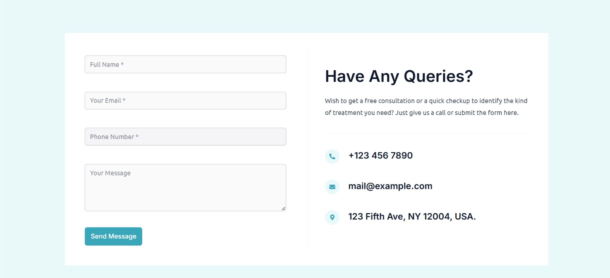

# Dental Clinic Website 🦷

This project is a dental clinic website developed using WordPress. The website was designed to give a dental clinic a professional online presence with a clean layout and organized pages.

The project focuses on website design, WordPress customization, and integrating functionality suitable for a healthcare business.

## Project Overview

The website presents a dental clinic through a structured layout that allows visitors to explore the website and access relevant clinic information. The design aims to provide a simple and convenient browsing experience.

## Technologies Used

- WordPress
- WordPress Theme
- Elementor
- WordPress Plugins

## Purpose

This project was created to gain practical experience in WordPress website development and to showcase my work in building websites for different types of businesses.

## 📸 Website Preview

### Homepage

### Services Page

### About Page

### Contact Page

